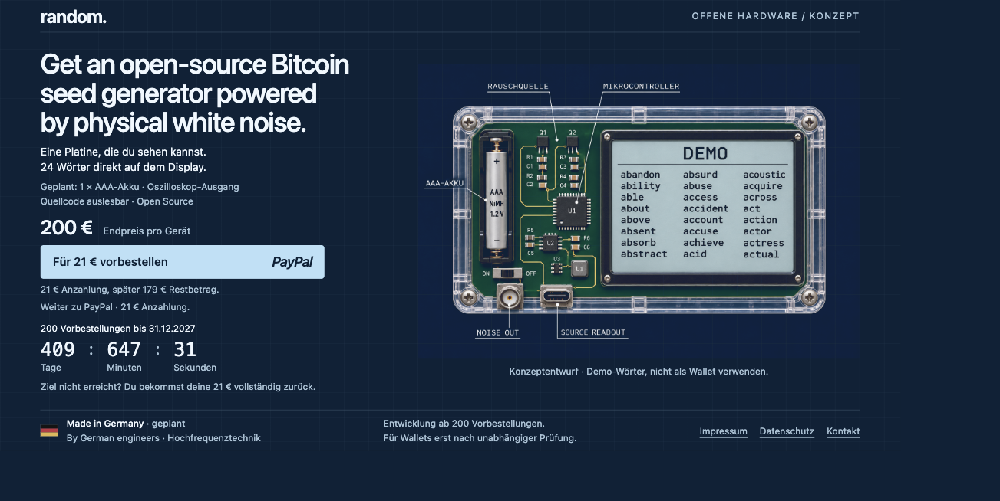

# random.

**Website:** https://random.eliaspfeffer.de/

English static site deployed to GitHub Pages at the user’s explicit request. GitHub Pages terms exclude sites primarily facilitating commercial transactions; this hosting remains subject to that limitation. Target delivery is spring2028.

Single-screen German CAD-style hardware concept preview. Legacy consent-based waitlist service retained, but not exposed by the new hero. Python standard library; no build or package installation.

## Run

`python3 server.py` serves http://127.0.0.1:8864. The waitlist stays closed until an actual provider address and `waitlist: true` are present in an untracked `config.json`. `config.example.json` documents the format. Do not use sample identities in production.

`python3 -m unittest discover -s tests -v` tests persistence, validation, closed state, rate limiting, privacy boundaries and retention.

## Scope and launch gates

The page shows the requested concept, €21 deposit, €200 final price and 200 paid-order development threshold. Free waitlist entries never count as paid orders. Hardware, firmware, entropy measurements and wallet seed support do not exist yet. Concept image is marked as AI visualization. The site software is MIT licensed; hardware licensing is undecided.

**Hosted PayPal checkout is connected locally; no payment capture/refund has been tested.** Paddle excludes physical goods and crowdfunding. PayPal Business session and hosted link are now confirmed; account approval for this preorder model, delivery/fulfillment terms, taxes, shipping, cancellation/refunds remain unresolved. Campaign deadline is end of 31 December 2027 Europe/Berlin; the seller promises full deposit refunds if fewer than 200 paid preorders are reached. Never relabel an unsuitable payment as a donation or digital good. Do not publish a buy button until the provider and seller terms are valid.

Before public launch: confirmed provider identity/address, final privacy hosting statement, TLS and DNS, off-host backup/restore check, authenticated business account and provider approval, sandbox checkout/capture/webhook/refund tests, and real mail confirmation for payment receipts. Launch notification emails are not automated; entries require an explicit operational send and deletion afterwards. Consent is collected but email ownership is not verified; do not interpret entries as verified customers.

## Deployment preparation

`deploy/random-waitlist.service` runs a dedicated low-resource dynamic user service, loopback only, with SQLite in `/var/lib/random-preorder`. Copy only this project to `/opt/random-preorder`. Put public business config in `/etc/random-preorder/config.json`. Keep credentials and customer data out of Git and the public directory. The app trusts X-Real-IP only because it binds to loopback; the dedicated proxy must overwrite this header.

The proposed Caddy host block is in `deploy/random-preorder.caddy`. It has not been imported. Shared ingress requires separately scoped authorization or an independently isolated entry point; do not reload shared services as part of this deployment.

Only the new `random` DNS record may be changed. Preserve all existing records.

## Data operations

The service stores email, timestamp and consent version in a private SQLite file. No public endpoint lists records. Duplicates return the same response. Rate limits use a daily hash, retained at most two calendar days. Automated hourly pruning deletes entries older than 365 days, so expiry may be delayed by up to one hour; the service must be running. On launch notification or withdrawal, remove the corresponding entry using a parameterized SQLite query through SSH. Backups must have a bounded retention policy and honor erasure requests.

## Assets

`public/blueprint.png` was generated with the built-in image tool. It shows a concept, not a prototype photograph; display words are illustrative only. The earlier concept.jpg is retained as an unused previous asset.

## Current preview (16 November 2026)

Lovable regeneration is paused because credits ran out. Local implementation is available at http://127.0.0.1:8864. No paid upgrade, deployment or checkout activation was performed. `node tests/test_countdown.mjs` checks six countdown boundaries. See [verification results](docs/verification.md). Real ego-lite checks cover 320×740, desktop, keyboard CTA, zero/expired timer and blocked payment state. The CTA now opens the verified 21 EUR PayPal hosted checkout. No transaction has been made. GitHub Pages and Porkbun DNS are configured; HTTPS provisioning and PayPal merchant settings are being finalized. Paid order counting and refunds are operational/manual, not automatic.
