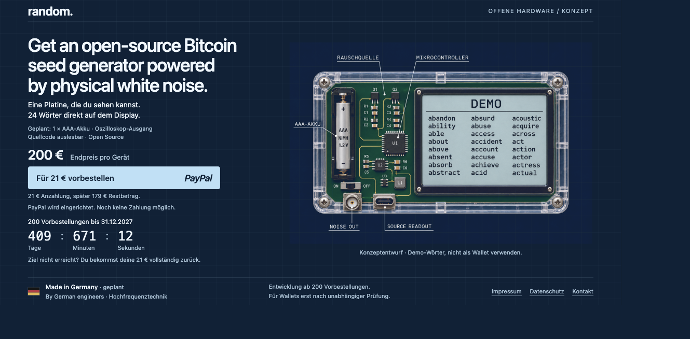

# Verification — 17 November 2026

## Result
Review build works locally. It is not ready to accept paid preorders.

## Passed
- Existing Python service suite: 5 tests, including validation, closed state and privacy boundaries.
- Countdown suite: 6 assertions including Berlin campaign deadline, day/minute rollover and expiration.
- Real ego-lite browser: current image loads; desktop1196×589 no overflow.
- Mobile320×740: longer English heading originally caused vertical overflow; font size adjusted; document now320×740.
- Keyboard Enter activates the preorder control and announces that no checkout exists. No order or payment created.
- Expired clock injection: CTA disabled and deadline-expired state displayed.
- Privacy page loads at /legal#datenschutz. Footer's last Contact link is keyboard focusable and uses the intended mailto address.
- Escape does not trap focus. No popovers or modal layers exist on this surface.
- Static asset HTTP200 verified previously; no external fonts or tracking included.

## Blocking the launch
- PayPal sign-in succeeded using existing browser autofill. Account is personal. PayPal's payment-link editor explicitly requires a Business account. No account conversion or payment was performed.
- Public seller address and deliverable fulfillment terms remain absent; legal page is clearly a draft.
- Paid-order persistence, verified payment callbacks, counting and refunds have not been implemented or tested. The UI has no fake current order count.
- GitHub Pages excludes sites primarily facilitating commercial transactions. This repository hosts source and a visual preview, not the live preorder shop. No Pages deployment was configured.
- Device drawing is illustrative. No entropy hardware, electrical BOM or Bitcoin-wallet security has been validated.

## Evidence

