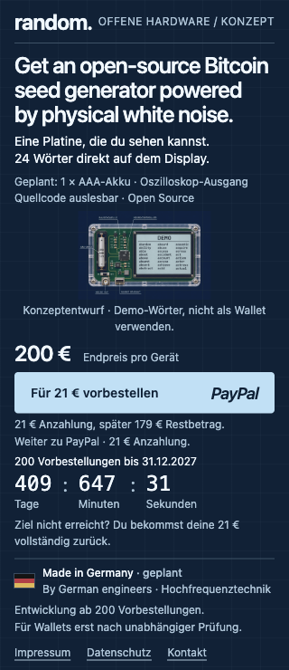

# Verification — 17 November 2026

## Result
Review build works locally. It is not ready to accept paid preorders.

## Passed
- Existing Python service suite: 5 tests, including validation, closed state and privacy boundaries.
- Countdown suite: 6 assertions including Berlin campaign deadline, day/minute rollover and expiration.
- Real ego-lite browser: current image loads; desktop1196×589 no overflow.
- Mobile320×740: longer English heading originally caused vertical overflow; font size adjusted; document now320×740.
- Keyboard Enter activates the preorder control and announces that no checkout exists. No order or payment created.
- Expired clock injection: CTA disabled and deadline-expired state displayed.
- Privacy page loads at /legal#datenschutz. Footer's last Contact link is keyboard focusable and uses the intended mailto address.
- Escape does not trap focus. No popovers or modal layers exist on this surface.
- Static asset HTTP200 verified previously; no external fonts or tracking included.

## Blocking the launch
- PayPal sign-in succeeded using existing browser autofill. Account is personal. PayPal's payment-link editor explicitly requires a Business account. No account conversion or payment was performed.
- Public seller address and deliverable fulfillment terms remain absent; legal page is clearly a draft.
- Paid-order persistence, verified payment callbacks, counting and refunds have not been implemented or tested. The UI has no fake current order count.
- GitHub Pages excludes sites primarily facilitating commercial transactions. This repository hosts source and a visual preview, not the live preorder shop. No Pages deployment was configured.
- Device drawing is illustrative. No entropy hardware, electrical BOM or Bitcoin-wallet security has been validated.

## Evidence

## PayPal continuation

Business session verified. Created hosted payment link LNLWF5H4LCK44, SKU RANDOM-PREORDER-21, fixed21 EUR, quantity1, shipping-address collection. Description includes concept status, total200 EUR, remaining179 EUR, target200, end31Dec2027 deadline and full-refund promise if target missed. Local CTA Enter navigates to the genuine PayPal checkout and shows correct item and21 EUR. Expiry still blocks navigation. Existing5 Python tests and6 countdown assertions pass. No payment/capture/refund test performed. Checkout keeps account-wide merchant home kartoffelpost.net, deliberately not changed for unrelated products. Launch blockers remaining: public seller address, delivery terms and production host. The earlier personal-account and absent-checkout blockers above are superseded by this continuation.

## English custom-domain deployment

User corrected seller address to Pestalozzistrasse65,72762 Reutlingen,Germany; postcode checked against DAAD. Target delivery spring2028 confirmed. All website text and image annotations translated to English. GitHub Pages workflow deployed successfully; DNS random changed from the old A record to CNAME eliaspfeffer.github.io (TTL600). GitHub custom domain configured. At this checkpoint HTTP serves correct English homepage; HTTPS certificate is pending provider provisioning. PayPal edit session expired, so English description and merchant-home update have not yet been saved; renewed user login requested.
